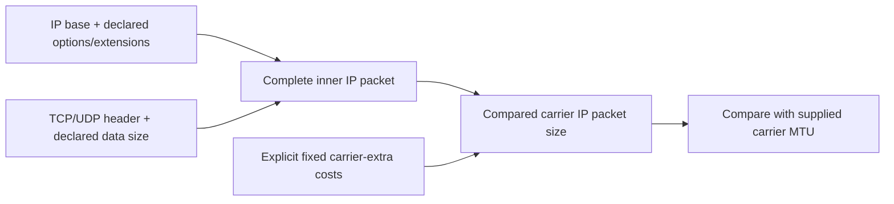

# Packet-size budget lab

An offline Python tool explaining whether invented IP headers, transport data and
fixed extra encapsulation costs fit an explicitly supplied carrier IP MTU budget.
It reports independent inner length-field checks, signed headroom and a component
ledger. No packets are generated, parsed, captured or sent.

## Setup and run

Standard library only. Python 3.11+ intended; verified here on Windows CPython 3.13.7.
No dependency installation or service. From this directory:

```powershell
python packet_budget.py examples/budgets.json
python packet_budget.py examples/mixed.json
Get-Content examples/empty.json -Raw | python packet_budget.py -
python -m unittest discover -s tests -v
python -O -m unittest discover -s tests -v
```

`analyze(data: exact bytes) -> dict` validates a bounded UTF-8 JSON document before
calculating. API admission/output-budget failure raises LabError; recognized
unsupported contexts return rows with null arithmetic. See [SCHEMA.md](SCHEMA.md)
for exact fields, compatibility, limits and units (octets).

| Budget demo | Expected outcome |
|---|---|
| IPv4 TCP, 1460 data +20 IP +20 TCP, MTU 1500 | equality fits |
| IPv6 TCP, 1460 data +40 IP +20 TCP, MTU 1500 | 20 over supplied MTU |
| IPv6 UDP +8 extension bytes, 1224 data, MTU 1280 | packet 1280, IPv6 length 1240, UDP length 1232 |
| IPv4 TCP, 1410 data, declared extras 20+8+8+14 | inner packet 1450, carrier 1500; each extra once |
| IPv4 UDP zero data, MTU 20 | packet 28, budget -8, maximum payload null |
| IPv4 UDP, 65508 data, MTU 100000 | MTU fits, inner IPv4 field exceeds 65535 |

Exit 0: all rows supported, including mathematical over-budget results and empty
input. Exit 3: any recognized fragmentation/jumbogram/offload context; derived values
null for those rows. Exit 2: malformed input or I/O/output failure, no report on
admission error. A failed delivery may leave partial output but never success.

## Layers and interpretation



IPv4 Total Length includes its header; IPv6 Payload Length excludes its fixed
40-byte base but includes extensions; UDP Length includes UDP header/data and
excludes all IP headers. The calculator checks each modeled field separately and
counts each supplied extra exactly once. It adds no implicit enclosing IP/UDP,
Ethernet, FCS or framing costs.

`fits_model` and `max_payload_bytes` describe only modeled inner fields plus the
supplied carrier budget. They do not establish enclosing packet validity, actual
delivery, path MTU, option contents, link minimum-MTU compliance, negotiated TCP MSS
or fragmentation behavior. These remain explicitly unverified beside every row.
The named IPv6 extension order is a teaching subset, not full packet validation.
Negative budgets remain negative; null capacity means even zero payload cannot fit.

## Security and verification

Inputs contain invented counts/labels only. Whole-document exact-type validation
precedes calculations, including unsupported cases. Bounds: 64 KiB input, depth six,
64 cases, two declared IPv6 extensions, four fixed extras, finite numeric ranges and
256 KiB compact JSON output. No payload allocation, addresses, sockets, subprocesses
or system inspection in the application. Logical bounds are not hard CPU/RSS limits.
See [SECURITY.md](SECURITY.md).

25 tests passed normal/-O; seven pre-code hand oracles and six independently literal
field-capacity cases pass; four demos have expected statuses. Actual closed stdout
and both-pipe closure, short write/flush/diagnostic failures return 2. Two deliberately
wrong models were detected by three assertion failures each, restored exactly, and
final normal/-O/compile/Bandit checks passed. Bandit 1.9.4 reports zero findings/errors
with seven narrow test/verifier subprocess rule exclusions; application none.
Implementing-agent ECC self-review found no unresolved confirmed defect.
[Verification report](verification/REPORT.md) and receipt bind exact files/checks.

With Bandit already installed, `python verification/verify.py` repeats the complete
local verification from any directory, checks frozen hashes, runs local mutations
and restores source in `finally`, then saves logs/receipt/latest-run status. Do not
run concurrently with edits or another verifier. Forced termination can bypass
restoration. It removes only this module's derived cache files. A failed latest run
marks any prior receipt historical. No tool downloads or external code execution.

No Linux/other Python version/hosted CI/CodeQL/advisory/Scorecard/dedicated secret
scanner or independent audit claim. Original scanner live Linux SYN remains unrun.

## Attribution and learning

Original tool under [MIT](LICENSE). JSON admission, CLI delivery and verifier patterns
adapted from Jake's MIT framing/route labs; no dpkt or third-party calculator source
copied. Research/licenses/alternatives in [RESEARCH.md](RESEARCH.md). AI assistance:
Codex research, implementation/tests/self-review; local qwen3.5:2b extracted four
supplied test labels. No remote worker inference or additional spending in this lab.

Optional exercise: raise IPv4 TCP options by 12 bytes in the equality case. Predict
the changed data budget and which length-domain count changes before running it.
See [LEARNING.md](LEARNING.md) and [DECISIONS.md](DECISIONS.md).

## Publication status

See [publication review](PUBLICATION.md) for the October 5 source snapshot, fresh local checks, evidence boundaries and current hosted-check distinction.
